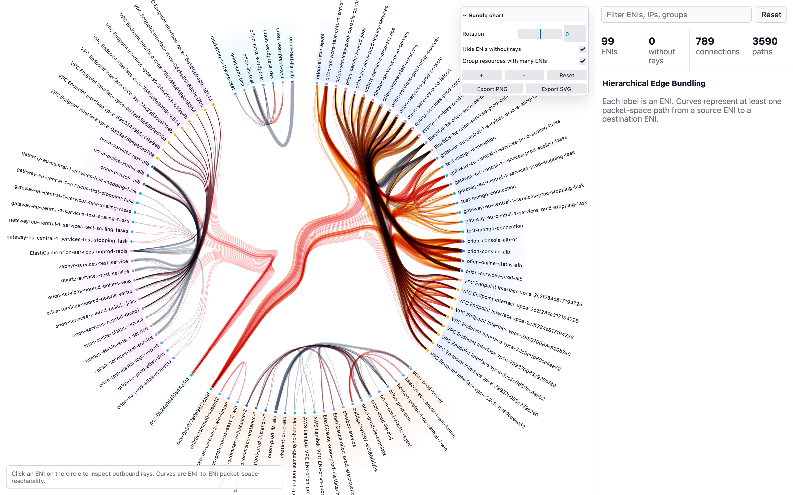
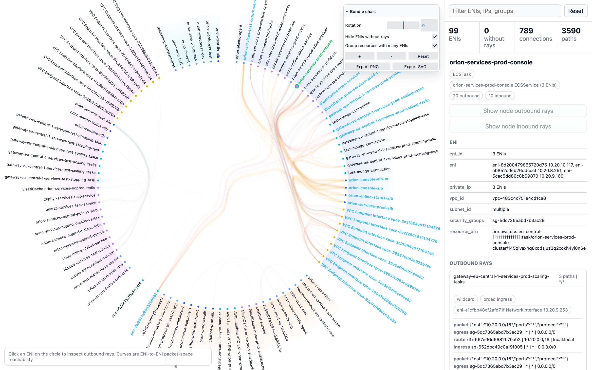
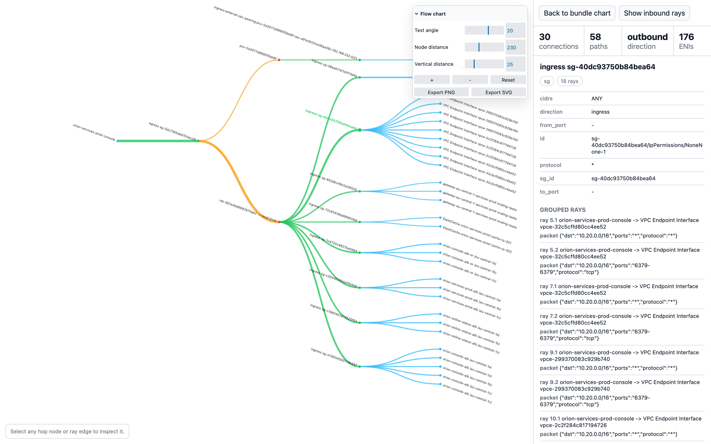

# Cartography Reachability

**See which AWS workloads can actually talk to each other, and why.**

Cartography Reachability reads the AWS inventory that [Cartography](https://github.com/cartography-cncf/cartography) loads into Neo4j. It traces every packet path between your network interfaces (ENIs) through security groups, route tables, VPC peering, Transit Gateways and load balancers. You then explore the result in an interactive edge-bundling graph, or let an AI agent query it through an MCP server.



<sub>Screenshots use anonymized data from a real multi-account AWS environment.</sub>

---

## Why

Security group rules and route tables are easy to read one at a time but hard to reason about together. "Can the CI runner reach the production database?" depends on an egress rule, a route (maybe through a peering connection or a Transit Gateway), an ingress rule and sometimes a load balancer listener, spread across several accounts.

This tool joins all of those for you and answers questions like:

- **What can this workload reach?** Every destination, with the exact protocol and port range that gets through.
- **What can reach this workload?** For example, everything that can open a connection to your Redis cluster.
- **Why is this path open?** Each path keeps its evidence: the egress rule, the route, any TGW or load-balancer hop, and the ingress rule.
- **Where is access too broad?** Paths that allow any protocol or port, or ingress open to `0.0.0.0/0`, are flagged and colored.
- **What crosses account or VPC boundaries?** Peering and Transit Gateway attachments to networks outside your inventory show up as external terminals.

Useful for network security reviews, least-privilege clean-ups, cloud migrations and onboarding onto an unfamiliar AWS estate.

## How it works

```
 AWS accounts ──► Cartography ──► Neo4j ──► raytrace-network-paths ──► packet_paths_bundle.json ──► bundle-frontend
                  (not included)              (this repo, Python)                                   (this repo, React + D3)
                                                     │
                                                     └──► cartography-reachability-mcp ──► AI agents (optional)
```

1. **Load.** The tracer queries Neo4j for ENIs and their owners (EC2, ECS tasks, Lambda, RDS, ElastiCache, load balancers, VPC endpoints and more), security group rules, route tables, peering connections, Transit Gateway attachments and route tables, and ELBv2 target groups.
2. **Ray-trace.** For each source ENI, an "all traffic" packet space is narrowed step by step: egress SG rule, then the route chosen by the source subnet's route table, then the destination's ingress SG rule (and ELB listener/target constraints where they apply). Whatever is left is a reachable path.
3. **Group.** ENIs that belong to the same workload and have identical outgoing paths (an ECS service's tasks, an ASG's instances, an ALB's per-AZ interfaces) are grouped to keep the graph readable.
4. **Render.** The result is written as one JSON file, which the frontend draws as a hierarchical edge bundle.

> [!NOTE]
> This project does **not** include or vendor Cartography. It builds on top of a Neo4j database that you have already populated with Cartography's AWS module.

## Getting started

### Prerequisites

| Tool | Version | Used for |
| --- | --- | --- |
| [Neo4j](https://neo4j.com/download/) | 5.x | Stores the Cartography graph |
| [Cartography](https://github.com/cartography-cncf/cartography) | recent | Ingests your AWS accounts into Neo4j |
| Python + [uv](https://docs.astral.sh/uv/) | 3.11+ | Runs the tracer and MCP server |
| Node.js | 20+ | Runs the frontend |

### 1. Populate Neo4j with Cartography

If you don't have a Cartography graph yet, follow the [Cartography AWS setup guide](https://docs.cartography.dev/modules/aws/config.html). A minimal run looks like:

```bash
docker run -d --name neo4j -p 7474:7474 -p 7687:7687 -e NEO4J_AUTH=neo4j/change-me neo4j:5
```

```bash
pip install cartography
```

```bash
cartography --neo4j-uri bolt://localhost:7687 --neo4j-user neo4j --neo4j-password-env-var NEO4J_PASSWORD --selected-modules aws
```

Use read-only AWS credentials (for example `SecurityAudit` + `ViewOnlyAccess`). For several accounts, see Cartography's multi-account options.

### 2. Install this project

```bash
git clone https://github.com/<you>/cartography-reachability.git
```

```bash
cd cartography-reachability && uv sync
```

```bash
cd bundle-frontend && npm install
```

### 3. Configure the Neo4j connection

```bash
cp .env.example .env
```

Then fill in `NEO4J_URI`, `NEO4J_USER`, `NEO4J_PASSWORD` and optionally `NEO4J_DATABASE`. Every value can also be passed as a CLI flag.

### 4. Trace reachability

Write the bundle straight into the frontend's `public/` folder:

```bash
uv run raytrace-network-paths --output bundle-frontend/public/packet_paths_bundle.json
```

On a few hundred ENIs this takes seconds. For very large estates, start with a filter or a limit (see [CLI reference](#cli-reference)).

### 5. Explore it

```bash
cd bundle-frontend && npm run dev
```

Open http://127.0.0.1:5173.

> [!WARNING]
> The generated JSON describes your real network: account IDs, IPs, security groups and resource names. `packet_paths_bundle.json` is git-ignored; keep it that way.

## Using the frontend

### Bundle view

Every dot on the circle is a workload or ENI, arranged by resource group and tinted by AWS account. Every curve is a reachable connection from source to destination.

| Edge color | Meaning |
| --- | --- |
| Red | **Wildcard**: any protocol or any port gets through |
| Orange | **Broad ingress**: the destination's ingress rule allows `0.0.0.0/0` |
| Grey | Scoped to specific protocols and ports |

Click a node to highlight what it can reach. The side panel lists its ENIs, security groups and every outbound path with the evidence chain (packet space, egress rule, route, ingress rule).



Controls (top-right panel):

- **Rotation**, zoom and reset.
- **Hide ENIs without rays** hides interfaces that reach nothing and are reached by nothing.
- **Group resources with many ENIs** merges per-AZ load balancer interfaces and similar into one node.
- **Export PNG / SVG** saves a 4000 × 4000 image for reports.
- The search box filters by name, ENI ID, IP or group.

The selected node is kept in the URL (`/?node=…`), so you can share a link to a specific view.

### Ray tree view

From a single (non-grouped) ENI, open **Show node outbound rays** or **Show node inbound rays** to see its paths as a tree: source → egress rule → route → ingress rule → destination. Click any hop to see the rule or route behind it and the rays that share it.



### Loading a different file

The frontend loads `/packet_paths_bundle.json` by default. To point it elsewhere:

```bash
VITE_BUNDLE_DATA_URL=/other-environment.json npm run dev
```

`npm run build` produces a static site in `bundle-frontend/dist/` that you can host anywhere next to your JSON file. Serve it with an SPA fallback to `index.html`, because the ray pages use `/rays/...` paths.

## CLI reference

```text
uv run raytrace-network-paths [options]
```

| Option | Default | Description |
| --- | --- | --- |
| `--uri` | `$NEO4J_URI` or `bolt://localhost:7687` | Neo4j Bolt URI |
| `--user` | `$NEO4J_USER` or `neo4j` | Neo4j user |
| `--password` | `$NEO4J_PASSWORD` | Neo4j password (required) |
| `--database` | `$NEO4J_DATABASE` | Neo4j database (server default if empty) |
| `--source` | all | Only trace from ENIs matching an ENI ID, owner ID/name, private or public IP |
| `--destination` | all | Only keep paths to ENIs matching the same kinds of values |
| `--source-limit` | `0` (no limit) | Max source ENIs to trace |
| `--pair-limit` | `0` (no limit) | Max source/destination pairs to evaluate |
| `--path-limit` | `0` (no limit) | Max paths to emit |
| `--output` | `packet_paths_bundle.json` | Output file |
| `--[no-]group-identical-rays` | on | Group ENIs of the same workload that have identical outgoing paths |

Examples:

```bash
uv run raytrace-network-paths --source 10.0.12.34 --output bundle-frontend/public/packet_paths_bundle.json
```

```bash
uv run raytrace-network-paths --destination prod-postgres --output bundle-frontend/public/packet_paths_bundle.json
```

## MCP server (optional)

The same traced data can be explored by an AI agent through the [Model Context Protocol](https://modelcontextprotocol.io). The server builds a resource-first index of the reachability graph and exposes tools that go from broad to narrow:

| Area | Tools |
| --- | --- |
| Orientation | `network_overview`, `filter_entities`, `entity_detail`, `top_connectivity_hotspots` |
| Reachability | `reachable_from`, `can_reach`, `edge_summary`, `edge_detail`, `edge_paths`, `path_explain` |
| Impact | `security_group_rule_impact`, `route_impact`, `top_security_group_rule_impacts`, `top_route_impacts` |
| Findings | `internet_exposed_resources`, `external_boundary_summary`, `sensitive_reachability_summary`, `finding_candidates`, `investigate_candidate` |
| Maintenance | `refresh_reachability_index` |

Run it over stdio. It reads the same `.env`.

```bash
uv run cartography-reachability-mcp
```

Example client configuration (Claude Code `.mcp.json`, Claude Desktop, VS Code and others use the same shape):

```json
{
  "mcpServers": {
    "cartography-reachability": {
      "command": "uv",
      "args": ["run", "--directory", "/path/to/cartography-reachability", "cartography-reachability-mcp"]
    }
  }
}
```

[`reachability_mcp/assessment_agent_prompt.md`](reachability_mcp/assessment_agent_prompt.md) has a ready-made system prompt for a network-assessment agent that uses these tools.

## Project structure

```
.
├── cartography_reachability/   # Tracer: Neo4j loader, ray tracer, grouping, bundle JSON renderer, CLI
│   ├── loader.py               #   Cypher queries against the Cartography schema
│   ├── tracer.py               #   SG → route → (TGW / ELB) → SG packet-space tracing
│   ├── overview.py             #   Workload grouping of ENIs
│   ├── renderers/bundle.py     #   Output format consumed by the frontend
│   └── cli.py                  #   `raytrace-network-paths`
├── reachability_mcp/           # Optional MCP server (`cartography-reachability-mcp`) + agent prompt
├── bundle-frontend/            # React + D3 + Vite viewer
│   ├── src/App.jsx
│   └── public/                 #   Put packet_paths_bundle.json here (git-ignored)
├── tests/                      # unittest suite (fixtures are synthetic)
├── docs/images/                # README screenshots
├── .env.example
└── pyproject.toml
```

## Development

```bash
uv run python -m unittest discover -s tests
```

```bash
cd bundle-frontend && npm run build
```

CI runs both on every push and pull request (`.github/workflows/ci.yml`).

## Limitations

The model is a static analysis of your configuration, not a packet capture. Keep in mind:

- **Network ACLs are not evaluated.** A path shown here can still be blocked by a NACL.
- **IPv4 only.** IPv6 routes and rules are ignored.
- **Security group rules:** CIDR ranges and SG-to-SG references are supported; managed prefix lists are not resolved yet.
- **The internet is not traced as a source.** Rules open to `0.0.0.0/0` surface as the *broad ingress* flag on internal paths instead.
- **External networks** (peered VPCs or TGW attachments outside your Cartography inventory) are modeled as terminal nodes; nothing is traced past them.
- Results are only as fresh as your last Cartography sync.

## License

No license has been chosen yet. Until one is added, all rights are reserved by the author.
